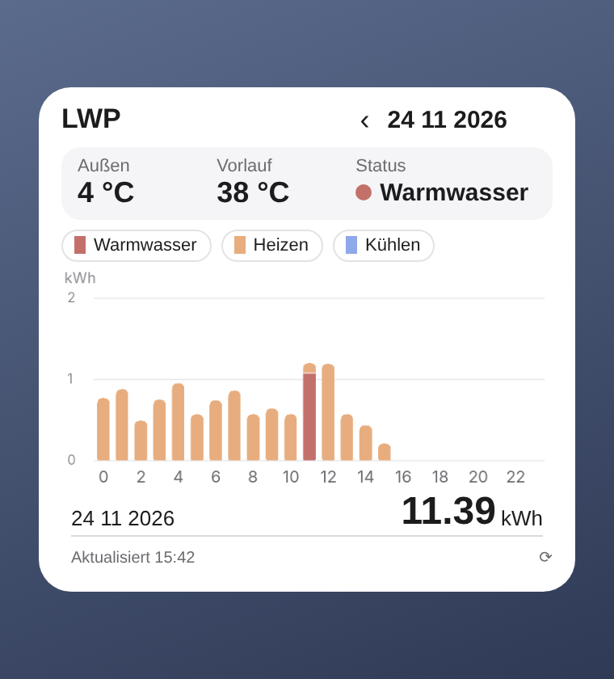

# LWP Widget – Panasonic-Wärmepumpe (Comfort Cloud) als Android-Widget

Ein Startbildschirm-Widget im Look des Comfort-Cloud-Monitors (Ansicht „Tag“) für Panasonic-Aquarea-Luftwärmepumpen:

- **Stündlicher Stromverbrauch** als Balken, gestapelt nach Warmwasser (rot), Heizen (orange) und Kühlen (blau), mit Tagessumme in kWh
- **Live-Werte:** Außentemperatur, Vorlauftemperatur und was die Pumpe gerade macht: *Heizt*, *Warmwasser*, *Taut ab*, *Bereit* oder *Aus*
- Mit ‹ › zu den Vortagen blättern (bis 13 Tage zurück), ⟳ zum sofortigen Aktualisieren
- Automatische Aktualisierung alle 15 Minuten (das ist das Minimum, das Android erlaubt)

Dazu gibt es eine kleine App: Anmeldung mit der Panasonic-ID, Auswahl der Wärmepumpe, Ein/Aus, Modus, Zonen- und Warmwasser-Solltemperatur.

## Installieren

1. Repository auf GitHub hochladen. Der Workflow **„APK bauen“** (`.github/workflows/build.yml`) läuft automatisch.
2. In GitHub unter **Actions → letzter Lauf → Artifacts** die Datei `LWP-Widget-APK` laden und entpacken.
3. Die APK aufs Handy kopieren und öffnen (einmalig „Apps aus dieser Quelle zulassen“ erlauben).
4. App öffnen, mit E-Mail und Passwort der Comfort-Cloud-App anmelden.
5. Widget hinzufügen: lange auf den Startbildschirm drücken → Widgets → „LWP Widget“.

Hinweis: Die APK ist mit einem Debug-Schlüssel signiert, den GitHub bei jedem Lauf neu erzeugt. Für ein Update die alte App vorher deinstallieren (oder einen eigenen Schlüssel als Secret hinterlegen).

Lokal bauen geht mit Android Studio oder `./gradlew :app:assembleRelease` (Android SDK nötig).

## Wie es funktioniert

Panasonic bietet keine offizielle Schnittstelle. Die App nutzt dieselbe Cloud-Schnittstelle wie die Comfort-Cloud-App (Anmeldung über die Panasonic-ID, Daten von `accsmart.panasonic.com`), so wie das Open-Source-Projekt [aioaquarea](https://pypi.org/project/aioaquarea/) für Home Assistant.

- Die Zugangsdaten bleiben verschlüsselt (Android-Keystore) auf dem Handy und gehen nur an Panasonic.
- Panasonic verlangt im Header eine aktuelle App-Version. Ist die Comfort-Cloud-App installiert, wird ihre Version verwendet, sonst die aus dem App Store.
- **Vorlauftemperatur:** Panasonic liefert kein einheitliches Feld dafür. Das Widget nimmt ein Vorlauf-Feld, wenn die Anlage eines meldet, sonst die Ist-Temperatur der (wassergeführten) Zone. Bei Heizkurven-Betrieb ist das die Vorlauftemperatur.
- Ändert Panasonic die Schnittstelle, kann die Anmeldung brechen. Dann hilft meist ein Blick, was `aioaquarea` angepasst hat.

## Aufbau

| Pfad | Inhalt |
|---|---|
| `api/` | Reiner Kotlin-Client für die Comfort Cloud (Login, Status, Verbrauch, Steuerung) mit Tests |
| `app/src/main/java/de/onur/aquarea/LwpWidget.kt` | Widget, Hintergrund-Aktualisierung |
| `app/src/main/java/de/onur/aquarea/ChartRenderer.kt` | Zeichnet das Balkendiagramm |
| `app/src/main/res/layout/widget_lwp.xml` | Layout des Widgets |
| `app/src/main/java/de/onur/aquarea/MainActivity.kt` | App: Anmeldung und Steuerung |
